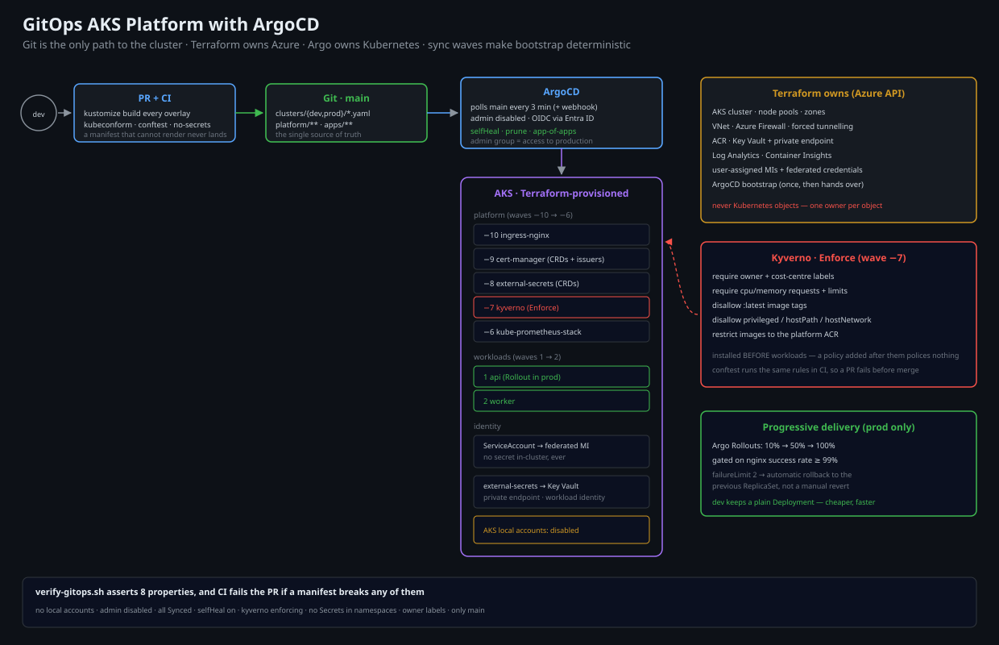

# GitOps AKS Platform with ArgoCD

A production-shaped AKS platform where **Git is the only way anything reaches the
cluster**. Terraform builds the cluster and the platform add-ons; ArgoCD owns
everything after that. No `kubectl apply` from a laptop, no CI pipeline with
cluster credentials.

> **Why this exists:** "we do GitOps" usually means "ArgoCD is installed and
> someone still runs kubectl on Fridays". The engineering is in the boundaries:
> what Terraform owns vs. what Argo owns, how a cluster bootstraps itself, how a
> bad commit is stopped before it reaches prod, and how you roll back in one
> revert.

---

## The ownership boundary

This is the single most important design decision in the repo, and the one most
GitOps setups get wrong.

| Concern | Owner | Why |
|---|---|---|
| AKS cluster, node pools, networking, DNS zone | **Terraform** | needs cloud credentials, is not Kubernetes-native |
| Azure Firewall / egress, private endpoints, Key Vault | **Terraform** | same |
| Workload identity federated credentials | **Terraform** | Entra ID objects, not K8s objects |
| ArgoCD itself (bootstrap) | **Terraform** → then **ArgoCD** | Terraform installs the chart once; Argo then manages its own version |
| Platform add-ons (ingress-nginx, cert-manager, external-secrets, kube-prometheus-stack, Kyverno) | **ArgoCD** | pure Kubernetes manifests, need drift correction |
| Workloads | **ArgoCD** | same |
| Namespaces, quotas, network policies | **ArgoCD** | same |

The rule: **if it is a Kubernetes object, Argo owns it. If it needs an Azure API
call, Terraform owns it.** The one overlap is ArgoCD's own installation, which
Terraform seeds and then hands over via a self-managing Application.

---

## Architecture



```
   developer ──▶ PR ──▶ CI (lint, kustomize build, conftest policy, dry-run)
                 │
                 ▼ merge to main
        ┌────────────────────────┐
        │  Git (this repo)       │◀──── single source of truth
        │  clusters/prod/*.yaml  │
        └───────────┬────────────┘
                    │  ArgoCD polls every 3 min (and on webhook)
                    ▼
   ┌──────────────────────────────────────────────────────────────┐
   │  AKS cluster (Terraform-provisioned)                         │
   │                                                              │
   │  argocd namespace                                            │
   │   └── app-of-apps  ──▶ ApplicationSet (per cluster, per env)  │
   │                                                              │
   │  platform (sync wave -10 → 0)                                │
   │   ├── ingress-nginx        (wave -10)                        │
   │   ├── cert-manager         (wave -9)                         │
   │   ├── external-secrets     (wave -8)                         │
   │   ├── kyverno              (wave -7)   ← admission policy     │
   │   └── kube-prometheus-stack(wave -6)                         │
   │                                                              │
   │  workloads (sync wave 0 → 10)                                │
   │   ├── api        (wave 0)                                    │
   │   └── worker     (wave 1)                                    │
   │                                                              │
   │  Workload identity: each app's ServiceAccount is federated    │
   │  to a user-assigned managed identity — no secrets in-cluster  │
   └──────────────────────────────────────────────────────────────┘
```

### Sync waves: the ordering that makes bootstrap work

A fresh cluster that applies everything at once deadlocks: workloads need
ingress-nginx's CRDs, external-secrets needs its CRDs before a `SecretStore`
exists, and Kyverno must be running *before* anything it polices is created.

Waves encode the dependency order declaratively:

```
-10  ingress-nginx        (provides Ingress + its webhook)
 -9  cert-manager         (provides Certificate CRDs)
 -8  external-secrets     (provides SecretStore CRDs)
 -7  kyverno              (admission webhooks — must exist before workloads)
 -6  kube-prometheus-stack
  0  namespaces, quotas, network policies
  1  workload: api
  2  workload: worker
```

---

## The GitOps properties this enforces

| # | Property | Enforced by |
|---|---|---|
| 1 | **No manual kubectl** | AKS local accounts disabled, no cluster-admin kubeconfig handed out; break-glass is a documented, audited procedure |
| 2 | **Drift is corrected, not tolerated** | ArgoCD `selfHeal: true`, `prune: true`; a drift alert fires if sync takes > 10 min |
| 3 | **Prod changes are reviewed** | ArgoCD only reads from `main`; branch protection + CODEOWNERS on `clusters/prod/` |
| 4 | **A bad commit cannot reach prod** | CI runs `kustomize build` + `conftest` policy + server-side dry-run against an ephemeral kind cluster |
| 5 | **Rollback is one revert** | ArgoCD syncs the reverted commit; `argocd app history` + rollback documented for emergencies |
| 6 | **No secrets in Git, ever** | external-secrets pulls from Key Vault via workload identity; a CI check greps for Secret manifests |
| 7 | **Every workload is accountable** | Kyverno requires `owner`, `cost-centre` labels and a resource limit on every pod |
| 8 | **Progressive delivery is possible** | Argo Rollouts installed; the api app demonstrates a 10% → 50% → 100% canary |

---

## Design decisions & trade-offs

**App-of-apps + ApplicationSet, not a single giant Application.**
One Application per app gives independent sync status, independent rollback and
independent blast radius. An ApplicationSet generates them per cluster, so adding
a cluster is one file.

**Kustomize, not Helm, for our own manifests.**
Helm for third-party charts (ingress-nginx, cert-manager — upstream is the source
of truth). Kustomize for our overlays because environment differences should be
visible as a diff, not as a values file with `if` conditions.

**Terraform does not manage Kubernetes objects.**
The `kubernetes`/`helm` Terraform providers would let Terraform do everything, and
that is exactly the trap: you end up with two systems that both think they own the
cluster, and a `terraform apply` that silently reverts Argo's changes (or worse,
the other way round). One owner per object, enforced by review.

**Kyverno before workloads, in `enforce` mode.**
An admission controller installed *after* workloads is a policy that polices
nothing until the next deploy. The sync wave ordering plus `validationFailureAction: Enforce`
means the rules are real from the first workload.

**Workload identity over pod-managed identity or secrets.**
Every app gets a ServiceAccount annotated with a federated credential. The pod
gets a token, exchanges it for an Azure token, and never sees a secret. This is
the same principle as project #3, applied in-cluster.

**ArgoCD UI exposed, but not the admin.**
The UI is behind ingress + OIDC (Entra ID) with an `argocd-admins` group. The
`admin` account is disabled. Access to ArgoCD is access to production, so it is
treated as such.

**No automated image updates (yet).**
ArgoCD Image Updater would auto-bump tags. It is deliberately not enabled: it
turns a reviewed change into an unreviewed one. The README's "what I'd do
differently" explains when to enable it.

---

## Repository layout

```
azure-gitops-aks-argocd/
├── infra/                        # Terraform: cluster + platform prerequisites
│   ├── main.tf                   # AKS, node pools, workload identity, Key Vault
│   ├── argocd.tf                 # bootstrap ArgoCD + the root app-of-apps
│   └── params/{dev,prod}.tfvars
├── clusters/
│   ├── dev/
│   │   ├── root-app.yaml         # app-of-apps entry point
│   │   └── cluster-config.yaml   # cluster-specific values (domain, replicas)
│   └── prod/
├── platform/                     # Argo-managed platform add-ons
│   ├── ingress-nginx/
│   ├── cert-manager/
│   ├── external-secrets/
│   ├── kyverno/
│   └── kube-prometheus-stack/
├── apps/
│   ├── base/                     # shared Deployment/Service/Ingress
│   └── overlays/{dev,prod}/      # replicas, resources, domain, image tag
├── policies/                     # Kyverno ClusterPolicies
├── scripts/
│   ├── bootstrap.sh              # terraform apply → argocd ready → root app
│   ├── verify-gitops.sh          # asserts the 8 properties above
│   └── drift-check.sh            # fails if any app is OutOfSync
└── docs/
    ├── runbook.md                # break-glass, stuck sync, rollback
    ├── cost.md
    └── diagrams/architecture.svg
```

---

## Deploy

```bash
az login
./scripts/bootstrap.sh prod

# 30 seconds later
argocd app list
./scripts/verify-gitops.sh prod
```

`verify-gitops.sh` asserts, and fails loudly if any is false:

```
[ok]   AKS local accounts are disabled
[ok]   no cluster-admin kubeconfig exists outside the break-glass vault entry
[ok]   every Application is Synced and Healthy
[ok]   no Application has auto-sync disabled
[ok]   kyverno is in Enforce mode and has 4 cluster policies
[ok]   no Secret object exists in any application namespace
[ok]   every pod has an owner label and a resource limit
[ok]   no Application points at a branch other than main
```

## Rollback

```bash
# the normal way: revert the commit
git revert <sha> && git push      # Argo syncs within 3 minutes

# the emergency way (audited, time-boxed)
argocd app rollback api 42        # to history revision 42
```

Documented in [`docs/runbook.md`](docs/runbook.md), including the one case where
you are allowed to `kubectl edit` (a stuck finalizer), and what to do afterwards.

---

## Cost

**~₹78,000/month** for prod (AKS control plane free tier, 3× Standard_D4s_v5
nodes ~₹42k, Azure Firewall for egress ~₹14k, Log Analytics ~₹9k, ingress public
IP ~₹300, Key Vault ~₹500, ACR ~₹4k). Full model plus the "use spot node pools
for the worker" saving in [`docs/cost.md`](docs/cost.md).

## What I would do differently at scale

- **One ArgoCD per cluster, or ArgoCD with a hub-and-spoke ApplicationSet**, once
  you pass ~10 clusters. A single ArgoCD managing 30 clusters is a single point of
  failure with a very large blast radius.
- **Enable ArgoCD Image Updater for dev only**, with prod promoting by PR. Auto-bump
  in prod turns reviewed changes into unreviewed ones.
- **Adopt Argo Rollouts for every workload**, not just the demo, and gate promotion
  on SLO metrics rather than a timer.
- **Add Crossplane for Azure resources that must live in-cluster** (a database per
  preview environment, for example) — but only after the Terraform/Argo boundary is
  stable, or you get three owners instead of two.

## License

MIT
